+++
title = 'Crear un portfolio con Hugo, Blowfish y GitHub Pages'  
date = 2026-08-13T09:24:37Z  
draft = false
showAuthor = true
featureimage = "./images/portada.png"
tags = ["Portfolio","Github", "Hugo"]
showTableOfContents = true
+++

En este tutorial vamos a crear una web de portafolio utilizando **Hugo** y el tema **Blowfish**. Una vez tengamos nuestra página configurada y funcionando en local, la subiremos a un repositorio de **GitHub** y la desplegaremos mediante **GitHub Pages**.

El objetivo es tener una web estática que podamos utilizar como portafolio personal y publicar gratuitamente en Internet.

## Requisitos previos

Antes de comenzar necesitaremos:

- Una cuenta de GitHub.
- Git instalado.
- Docker instalado o una máquina Linux donde realizar la instalación.
- Conocimientos básicos de terminal Linux.

Este tutorial está orientado a Linux. En mi caso, voy a realizar todo el proceso dentro de un contenedor LXC alojado en mi servidor Proxmox.

---

## Instalación de Hugo

Lo primero será instalar HUGO. Para este tutorial utilizaremos la versión **0.165.0 Extended**.

Descargamos e instalamos Hugo:

#### [Enlace al Github de HUGO](https://github.com/gohugoio/hugo/releases/tag/v0.165.0)

```bash
# Descargar versión 0.165 de Hugo
wget https://github.com/gohugoio/hugo/releases/download/v0.165.0/hugo_extended_0.165.0_linux-amd64.deb
# Instalar versión 0.165 de Hugo
dpkg -i hugo_extended_0.165.0_linux-amd64.deb
# Versión de Hugo
hugo version
```
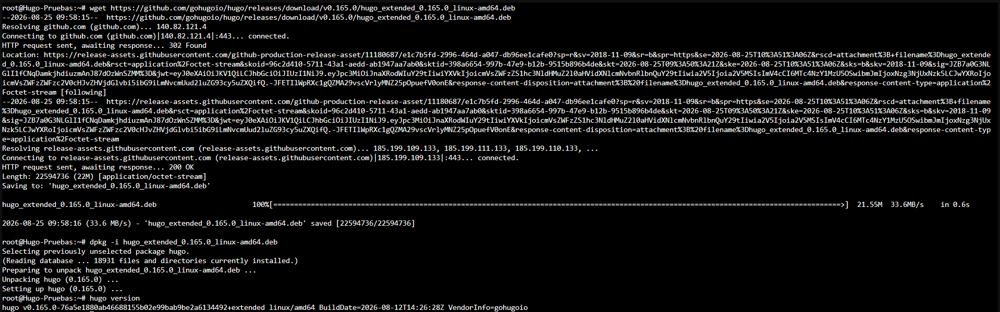


> **Nota:** Git debe estar instalado previamente, ya que lo utilizaremos para gestionar nuestro proyecto y posteriormente subirlo a GitHub.

---

## Crear el proyecto

Una vez instalado Hugo, podemos crear nuestro proyecto. Ejecutamos lo siguiente:

```bash
# Crear la carpeta de la web
mkdir portafolio
# Entramos y creamos el nuevo sitio
cd portafolio
hugo new site portafolio
# Iniciamos el repositorio de Github
git init
```
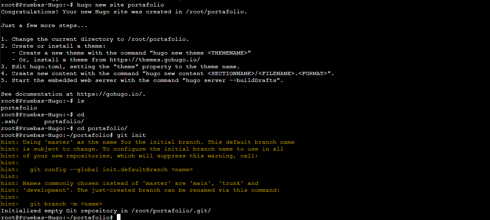

Vamos a probar si Hugo está desplegado correctamente con el comando:

```bash
hugo server --bind 0.0.0.0 --baseURL http://[mi_ip]:1313 -D
```

Con esto desplegamos nuestra web de Hugo en local. Ahora mismo como no tenemos ninguna plantilla, al buscar la dirección nos saldrá la siguiente captura.

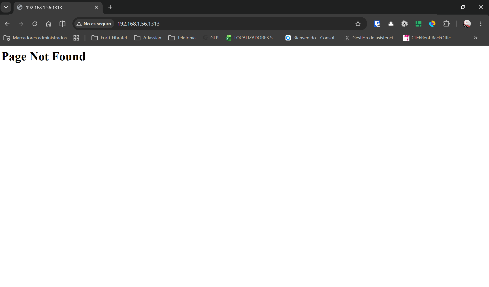

Esto muestra, que aunque no hay ninguna página, **Hugo está funcionando correctamente** local. 

---

## Instalar el tema de Blowfish

Ahora vamos a añadirle un tema, en este caso añadiremos el tema de blowfish que es muy personalizable y con una gran cantidad de documentación (abajo dejo el enlace).

#### [Enlace a Blowfish](https://blowfish.page/)

Añadimos Blowfish como submódulo de Git:
Esto nos permitirá mantener el tema separado de nuestro proyecto y actualizarlo fácilmente en el futuro.

```bash
git submodule add https://github.com/nunocoracao/blowfish.git themes/blowfish
```

Después de añadir el tema, necesitamos importar una configuración inicial.
Blowfish incluye un proyecto de ejemplo con varios archivos de configuración que podemos utilizar como punto de partida.
Primero eliminamos el archivo de configuración creado automáticamente por Hugo:
```bash
rm hugo.toml
```
A continuación, copiamos la carpeta `config` incluida en el ejemplo de Blowfish:
```bash
cp -r themes/blowfish/exampleSite/config .
```
La estructura de nuestro proyecto debería quedar similar a esta:
```text
portafolio/
├── config/
├── content/
├── themes/
│   └── blowfish/
└── ...
```

Después de esto levantamos de nuevo el servidor de hugo y nos arranca la página de blowfish

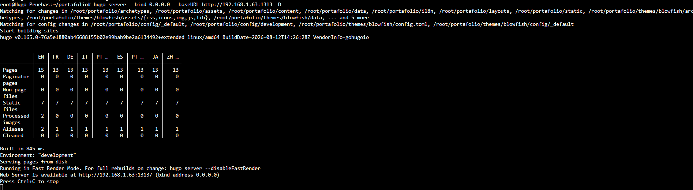

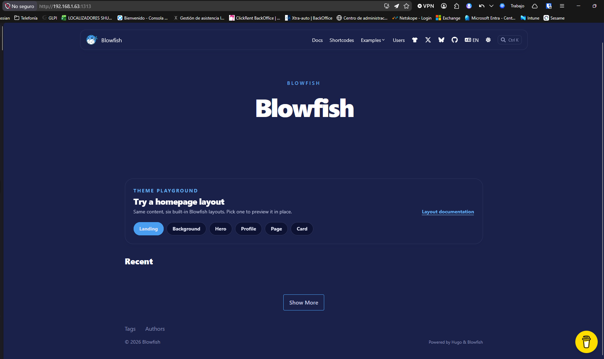

Ahora ya podemos modificar nuestra web de Blowfish a nuestro antojo, aquí no explico como modificar blowfish, solo como desplegarlo en local y luego en GitHub Pages. Mi recomendación es que explores la documentación de Blowfish

## Despliegue en github pages

Una vez subido a tu repositorio de Github, vamos a subirlo a una github pages para poder mostrarlo en internet.

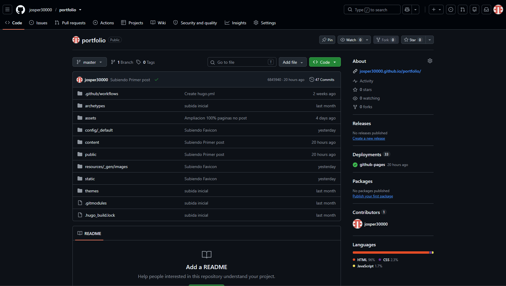

En nuestro repositorio vamos a **Settings → Pages**

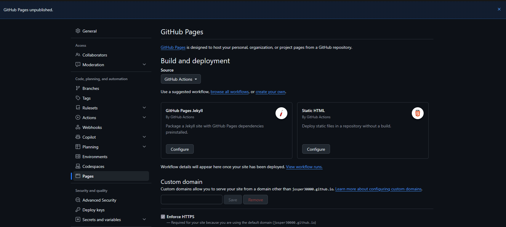

Aquí muestra diferentes formas de desplegar la github pages, en este caso le pulsaremos a *"browse all workflows"*. Aquí saldrán diferentes formas de desplegar nuestra web, en el buscador pondremos **Hugo** y pulsaremos en configurar.

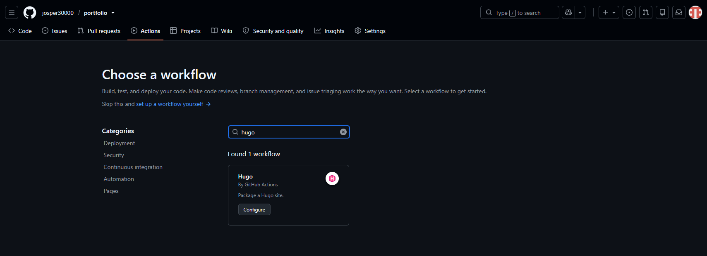

Aquí saldrá el archivo de configuración de Hugo, tendremos que cambiar la versión, en nuestro caso es la **0.165.** Después de esto pulsamos en "Commit changes" y aceptamos.

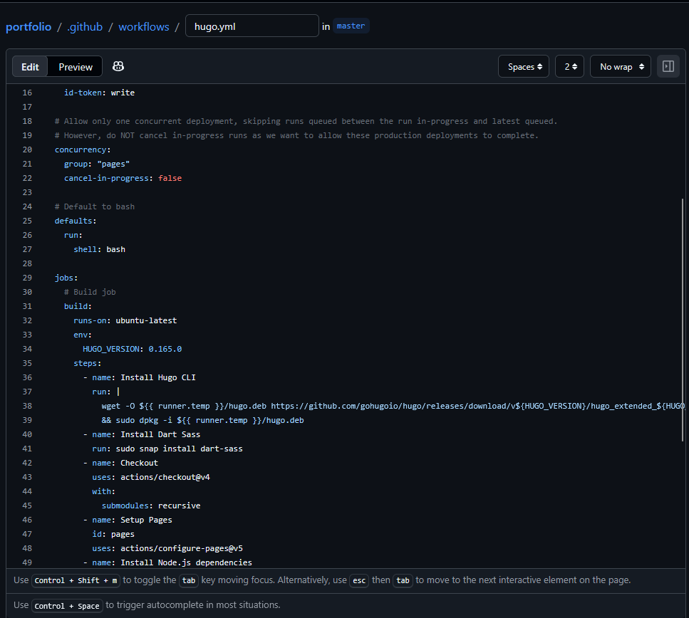

Luego tendremos que esperar para mientras se desplega la web. Pero Conforme termine ta tendremos la web desplegada.

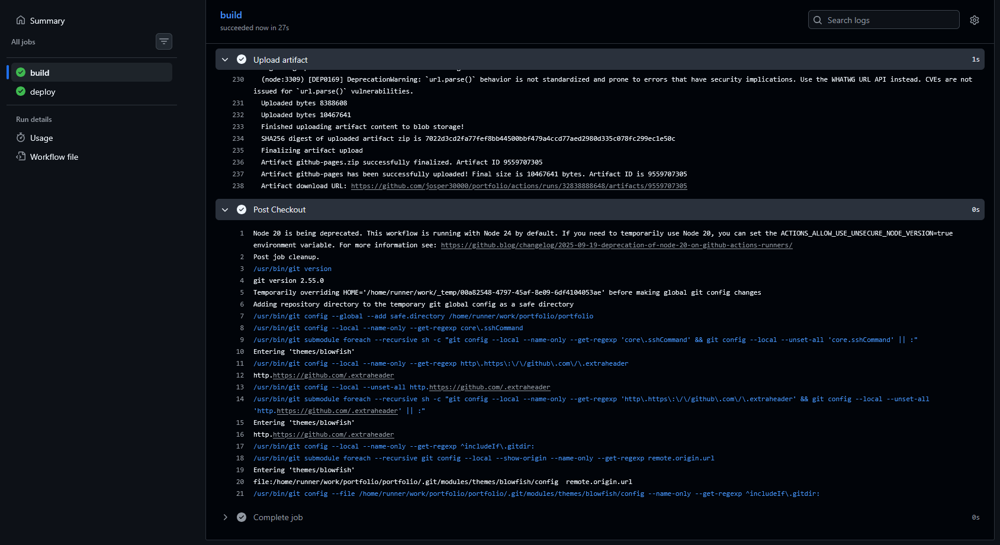

Con esto ya está desplegada nuestra web de Hugo y Blowfish en Github.

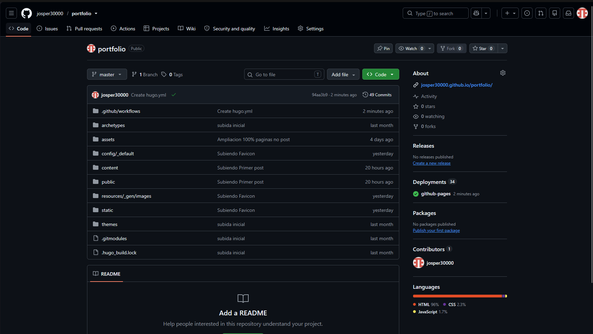

[Enlace a mi Web](https://josper30000.github.io/portfolio/)

**Espero que os haya gustado el tutorial, para cualquier duda o sugerencia, podemos hablar por los canales de contacto. Gracias y nos vemos.**
