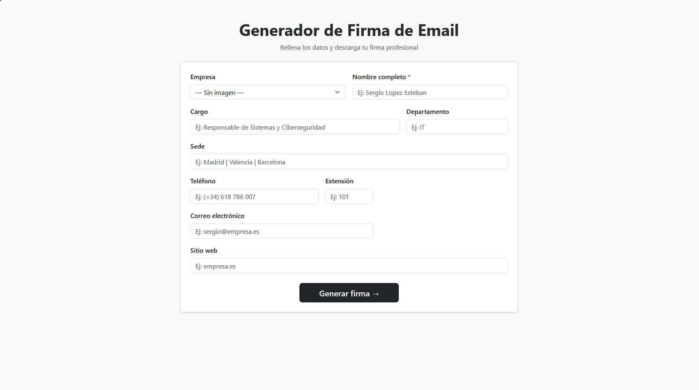
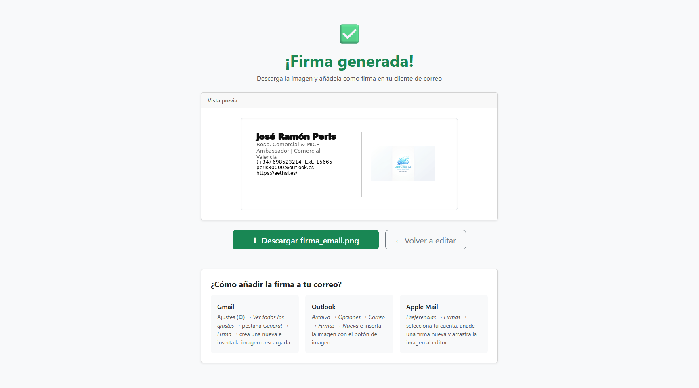

+++
title = 'Generador de firmas: Programa en Python'  
date = 2026-09-01T09:24:37Z  
draft = false
showAuthor = true
featureimage = "./images/portada.png"
tags = ["Mail","Python", "Github"]
showTableOfContents = true
+++

# ✉️ Generador de Firmas de Correo Corporativas

**Aplicación web ligera desarrollada en Python para automatizar, estandarizar y simplificar la creación de firmas de correo electrónico en entornos corporativos multi-empresa.**

## 📌 Contexto y Desafío

En mi empresa, la configuración y estandarización de las firmas de correo representaba un punto de fricción constante. Los empleados solían tener dificultades para estructurar sus firmas manualmente, lo que provocaba inconsistencias en la identidad de marca, desalineaciones visuales y una carga recurrente de tickets de soporte técnico.

A lo largo del tiempo se intentó abordar esta problemática mediante distintas guías y plantillas manuales, sin conseguir una solución definitiva. Ante esta situación, asumí el reto de crear un sistema centralizado que fuera extremadamente intuitivo para el usuario final y, al mismo tiempo, **fácil de mantener y extender para el equipo.**

## 💡 La Solución

Desarrollé una herramienta web que automatiza el proceso de generación a partir de un formulario accesible para cualquier perfil técnico o no técnico:

- **Formulario sencillo:** El usuario selecciona la empresa correspondiente del grupo, completa sus datos corporativos y genera su firma en un clic.

- **Soporte multimedia:** Capaz de procesar tanto imágenes estáticas como GIFs animados para dar cabida a firmas con logotipos dinámicos.

- **Descarga directa:** Entrega una firma completamente funcional y lista para integrar en su cliente de correo preferido.

## 🛠️ Arquitectura y Mantenibilidad

Un aspecto clave durante el desarrollo fue priorizar la **escalabilidad** y **mantenibilidad** del código:

- **Estructura modular:** Permite incorporar nuevas empresas, actualizar logos o modificar diseños existentes sin necesidad de tocar la lógica del núcleo de la aplicación.

- **Cero barreras de entrada:** Cualquier miembro del equipo puede añadir una nueva plantilla en minutos sin requerir conocimientos avanzados en la herramienta.

### Stack Tecnológico

- **Backend:** Python con Flask

- **Procesamiento de imagen:** Pillow (PIL) para la composición tipográfica y manipulación de capas/GIFs

- **Frontend:** HTML5 y CSS3

## 🚀 Enlaces y Recursos

- 📂 **Repositorio de GitHub:** [Añade la URL de tu repositorio aquí]